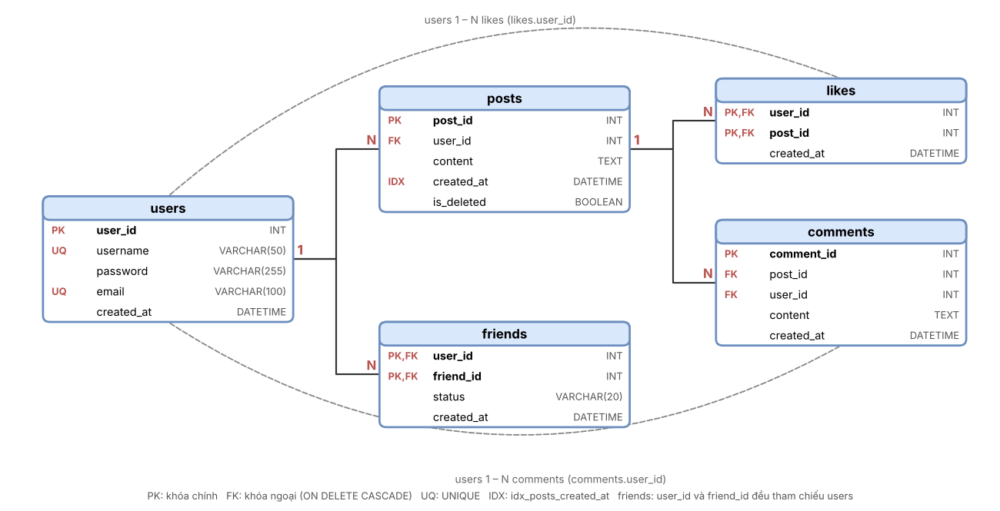

# Mini Project: Cơ sở dữ liệu "Social Network"

Xây dựng phân hệ xử lý dữ liệu (Database Layer) cho một mạng xã hội thu nhỏ trên MySQL 8.0: thiết kế 5 bảng có toàn vẹn tham chiếu, đóng gói nghiệp vụ thành 2 View và 3 Stored Procedure, tối ưu bằng chỉ mục, và hỗ trợ xóa mềm bài viết.

## 1. Mục tiêu và phạm vi

| # | Chức năng | Đối tượng | Kỹ thuật chính |
|---|---|---|---|
| 1 | Hiển thị hồ sơ người dùng an toàn | View `view_user_info` | Chỉ lộ các cột an toàn, ẩn `password` |
| 2 | Báo cáo thống kê tương tác | View `view_post_statistics` | `LEFT JOIN` 4 bảng, `COUNT` + `GROUP BY` |
| 3 | Đăng ký tài khoản | Procedure `sp_add_user` | Kiểm tra email trùng, `SIGNAL` báo lỗi |
| 4 | Đăng bài viết & điều hướng | Procedure `sp_create_post` | Tham số `OUT` + `LAST_INSERT_ID()` |
| 5 | Danh sách bạn bè phân trang | Procedure `sp_get_friends` | Lọc `'accepted'`, `LIMIT` / `OFFSET` |
| + | Xóa mềm bài viết | Cột `posts.is_deleted` | View chỉ thống kê bài chưa xóa |

**Yêu cầu kỹ thuật:** chỉ mục `idx_posts_created_at` trên cột thời gian của bảng bài viết; mọi khóa ngoại cấu hình `ON DELETE CASCADE`; dữ liệu giả lập có ít nhất 3 người dùng, 3 bài viết kèm thích, bình luận, kết bạn.

## 2. Phân tích và thiết kế

### 2.1. Các bảng dữ liệu

| Bảng | Vai trò | Khóa chính | Khóa ngoại |
|---|---|---|---|
| `users` | Tài khoản người dùng | `user_id` | — |
| `posts` | Bài viết | `post_id` | `user_id` → `users` |
| `likes` | Lượt thích | `(user_id, post_id)` | `user_id` → `users`, `post_id` → `posts` |
| `comments` | Bình luận | `comment_id` | `post_id` → `posts`, `user_id` → `users` |
| `friends` | Quan hệ bạn bè | `(user_id, friend_id)` | `user_id` → `users`, `friend_id` → `users` |

### 2.2. Mối quan hệ

| Bảng 1 | Bảng 2 | Quan hệ | Ý nghĩa |
|---|---|---|---|
| users | posts | 1 – N | Một người đăng nhiều bài |
| posts | likes | 1 – N | Một bài có nhiều lượt thích |
| users | likes | 1 – N | Một người thích nhiều bài |
| posts | comments | 1 – N | Một bài có nhiều bình luận |
| users | comments | 1 – N | Một người viết nhiều bình luận |
| users | friends | 1 – N (2 lần) | Bảng `friends` tham chiếu `users` hai lần: người gửi (`user_id`) và người nhận (`friend_id`) lời mời |

`likes` và `friends` thực chất là bảng trung gian của hai quan hệ **nhiều – nhiều**: users – posts (thích) và users – users (kết bạn).

### 2.3. Sơ đồ ERD



[Mở sơ đồ ERD trên draw.io](https://www.draw.io/?title=erd-social-network.drawio#R7Zpdb5swFIZ%2FTaTtZsImpPQyIWSr1o8tzbbeVRY4YNXgyDhNs18%2FAyYpIWmQmnpAK0VRfPyB%2FZyDeY9Dz3SipzmhuAeNkCWiZ457EPocrQiTP3qm2zMdn6CAo0g2iVGE8ybudLypj56%2BcrQIr5iPaW7hjImizsGUyq7EzzsaaTc4OVALslpjgTiORZ0OAuY9HhFdqqktE8yT3JqINVXWZEUiimJZGs1ZLG5VDZBlLyTUv0RrtkwvmQjkPRSlUcg4%2BSvbI6oay2oubsnftLNppKMRSh1GGc%2BuY46Hrj1xsoacPeBnNQPHdkdyHSPOlrGPfTVgNpt8PNCXZbUezAV%2BOggFPIePWYQFX8smqkM%2FZ2asVeMzVV4RX4S5DZ4rW4hJEBajDpQRJbkh2Ay9dYH8obyw3yOeWfHIj%2B%2B91I3bT%2Bqie9lBFsyh%2FL64nlUcJpefOgBREsTSQvE8LaZciIfoUJkj4vtpj1GyQB6Jg8us2djeAQt33F4bdB5fVdIKrVmTLBycAGy%2FAvbXzz1gs5u0IPt7OHW%2BDaefLOPz2xM%2BBVFroJGoVSG6wzP%2FLFCSrBj3K1ShZbUEqw01Yh0cD1QcIUIrPIHRljAFhq0R6Fm9OPU4RgL790hsyI6HM3d2ceW2hKrZ10dV2BWqCymB3rl0MMvawdQqHc6PS4fURS2RDnZzpAMwKmQnjRBlpyCpVTIAUHMvlgtNF1DQnLl3LcGpVSqAav52Mb5r2UPNbpBUAGa9%2BCTJvUzXsSS7wTq6ubl0h9ctoapVKoBq7kXJA37fWsGGZa0A62qF4oZ4XaBbe8WCUzzXWnTGkEdXQ5TC4GWsLdJfR7DqlQ3dSeGOYNUpHwSo5nAeiyI52Y%2Btubw1a83jQI1ETvmpLXtJg5I5WCOZ%2By%2Fb9ElQat2WIWh1XgwalMlB2P7EGDQpk4NmdyRDk3I5WM3l5pzg2P84%2BS2d%2FNY%2B%2Bi2897po7046BxuUzsEj6Vwe%2Bd0Aq1c51Ezo5K0vlkn1n%2BMG%2FdHZb5CIsLvzT2e%2FOVoCw%2FMKFuwHuLgFGRchC1iMqLu1juTGMOScrWQDdxqheF08yUpW%2FyZWjSckncDYKJqVyulz7Y9aKvhibTCm03j5iSVnzZbcw%2BUXvuQFAnzkqJhjigR5LI%2F%2FKo7F3t0BjvYejoeOdt4AJOg2SH0RCTt9Z2uMSLPbIPVFZL%2FTIKG%2BiLQOJKqZXG8aYh8l4SY%2FbQFvWdy%2Bpp7V7b7FLo3Fq%2B%2FbRtnL8qb7Dw%3D%3D)

### 2.4. Quyết định thiết kế

- **Mật khẩu:** cột `password` lưu **chuỗi băm** (`SHA2(..., 256)`), không lưu mật khẩu gốc. Trong hệ thống thật nên băm ở tầng ứng dụng bằng thuật toán chuyên dụng có salt như bcrypt hoặc Argon2.
- **`username` và `email` có `UNIQUE`:** chặn trùng lặp ở mức dữ liệu, kể cả khi có ai đó ghi thẳng vào bảng mà không qua thủ tục.
- **`likes` dùng khóa chính kép `(user_id, post_id)`:** mỗi người chỉ thích một bài một lần.
- **`friends` lưu một dòng cho mỗi cặp bạn bè:** `user_id` là người gửi, `friend_id` là người nhận lời mời, `status` là `'pending'` hoặc `'accepted'`. Ràng buộc `CHECK (user_id <> friend_id)` chặn tự kết bạn với chính mình.
- **`ON DELETE CASCADE` cho mọi khóa ngoại:** xóa một người dùng sẽ tự xóa bài viết, lượt thích, bình luận và quan hệ bạn bè của họ; xóa một bài viết sẽ tự xóa lượt thích và bình luận của bài đó. Không còn dữ liệu "mồ côi".
- **Xóa mềm (`is_deleted`):** bài viết bị "xóa" chỉ được đánh dấu, dữ liệu vẫn còn để khôi phục, đối soát hoặc phục vụ kiểm duyệt.

## 3. Triển khai cấu trúc dữ liệu

### 3.1. Tạo bảng

```sql
CREATE TABLE users (
    user_id    INT AUTO_INCREMENT PRIMARY KEY,
    username   VARCHAR(50)  NOT NULL UNIQUE,
    password   VARCHAR(255) NOT NULL,                 -- lưu chuỗi băm, không lưu mật khẩu gốc
    email      VARCHAR(100) NOT NULL UNIQUE,
    created_at DATETIME     NOT NULL DEFAULT CURRENT_TIMESTAMP
);

CREATE TABLE posts (
    post_id    INT AUTO_INCREMENT PRIMARY KEY,
    user_id    INT      NOT NULL,
    content    TEXT     NOT NULL,
    created_at DATETIME NOT NULL DEFAULT CURRENT_TIMESTAMP,
    is_deleted BOOLEAN  NOT NULL DEFAULT FALSE,       -- mở rộng: xóa mềm
    CONSTRAINT fk_posts_user FOREIGN KEY (user_id)
        REFERENCES users(user_id) ON DELETE CASCADE
);

CREATE TABLE likes (
    user_id    INT      NOT NULL,
    post_id    INT      NOT NULL,
    created_at DATETIME NOT NULL DEFAULT CURRENT_TIMESTAMP,
    PRIMARY KEY (user_id, post_id),                   -- mỗi người chỉ thích 1 bài 1 lần
    CONSTRAINT fk_likes_user FOREIGN KEY (user_id)
        REFERENCES users(user_id) ON DELETE CASCADE,
    CONSTRAINT fk_likes_post FOREIGN KEY (post_id)
        REFERENCES posts(post_id) ON DELETE CASCADE
);

CREATE TABLE comments (
    comment_id INT AUTO_INCREMENT PRIMARY KEY,
    post_id    INT      NOT NULL,
    user_id    INT      NOT NULL,
    content    TEXT     NOT NULL,
    created_at DATETIME NOT NULL DEFAULT CURRENT_TIMESTAMP,
    CONSTRAINT fk_comments_post FOREIGN KEY (post_id)
        REFERENCES posts(post_id) ON DELETE CASCADE,
    CONSTRAINT fk_comments_user FOREIGN KEY (user_id)
        REFERENCES users(user_id) ON DELETE CASCADE
);

CREATE TABLE friends (
    user_id    INT         NOT NULL,                  -- người gửi lời mời
    friend_id  INT         NOT NULL,                  -- người nhận lời mời
    status     VARCHAR(20) NOT NULL DEFAULT 'pending',
    created_at DATETIME    NOT NULL DEFAULT CURRENT_TIMESTAMP,
    PRIMARY KEY (user_id, friend_id),
    CONSTRAINT chk_friends_status CHECK (status IN ('pending', 'accepted')),
    CONSTRAINT chk_friends_not_self CHECK (user_id <> friend_id),
    CONSTRAINT fk_friends_user FOREIGN KEY (user_id)
        REFERENCES users(user_id) ON DELETE CASCADE,
    CONSTRAINT fk_friends_friend FOREIGN KEY (friend_id)
        REFERENCES users(user_id) ON DELETE CASCADE
);
```

### 3.2. Chỉ mục

```sql
CREATE INDEX idx_posts_created_at ON posts (created_at);
CREATE INDEX idx_friends_friend_status ON friends (friend_id, status);   -- tra cứu chiều ngược lại
```

- `idx_posts_created_at`: phục vụ các truy vấn sắp xếp và lọc bài viết theo thời gian (bảng tin mới nhất, bài viết trong khoảng ngày), tránh quét toàn bảng `posts`.
- `idx_friends_friend_status`: khóa chính `(user_id, friend_id)` chỉ hỗ trợ tìm theo người gửi. Chỉ mục bổ sung này giúp tìm nhanh theo **người nhận** lời mời, chiều mà `sp_get_friends` cũng phải tra cứu.

### 3.3. Dữ liệu giả lập

| Bảng | Số bản ghi | Ghi chú |
|---|---|---|
| `users` | 5 | `an_nguyen`, `binh_tran`, `cuong_le`, `dung_pham`, `ha_vu` |
| `posts` | 5 | Bài 4 đã xóa mềm; bài 5 chưa có tương tác nào |
| `likes` | 7 | Có 1 lượt thích trên bài đã xóa mềm |
| `comments` | 6 | Có 1 bình luận trên bài đã xóa mềm |
| `friends` | 5 | 4 quan hệ `accepted`, 1 lời mời `pending` |

Câu lệnh `INSERT` đầy đủ nằm trong file `social_network.sql`.

## 4. Triển khai chức năng

### Chức năng 1: Hồ sơ người dùng an toàn – `view_user_info`

```sql
CREATE OR REPLACE VIEW view_user_info AS
SELECT user_id, username, email, created_at
FROM users;
```

View chỉ chứa 4 cột được phép. Ứng dụng có lỡ viết `SELECT * FROM view_user_info` thì cũng không thể đọc được `password`, vì cột này không tồn tại trong View. Để bảo vệ trọn vẹn, tài khoản của ứng dụng nên chỉ được cấp quyền `SELECT` trên View, không cấp quyền trên bảng `users`.

| user_id | username | email | created_at |
|---|---|---|---|
| 1 | an_nguyen | an.nguyen@gmail.com | 2026-01-05 08:00:00 |
| 2 | binh_tran | binh.tran@gmail.com | 2026-01-10 09:30:00 |
| 3 | cuong_le | cuong.le@gmail.com | 2026-02-01 14:15:00 |
| 4 | dung_pham | dung.pham@gmail.com | 2026-02-20 20:45:00 |
| 5 | ha_vu | ha.vu@gmail.com | 2026-03-03 07:10:00 |

### Chức năng 2: Thống kê tương tác – `view_post_statistics`

```sql
CREATE OR REPLACE VIEW view_post_statistics AS
SELECT p.post_id,
       u.username                    AS author,
       p.content,
       p.created_at,
       COUNT(DISTINCT l.user_id)     AS total_likes,
       COUNT(DISTINCT c.comment_id)  AS total_comments
FROM posts AS p
INNER JOIN users    AS u ON u.user_id = p.user_id
LEFT  JOIN likes    AS l ON l.post_id = p.post_id
LEFT  JOIN comments AS c ON c.post_id = p.post_id
WHERE p.is_deleted = FALSE
GROUP BY p.post_id, u.username, p.content, p.created_at;
```

- `LEFT JOIN` với `likes` và `comments` giữ lại cả những bài **chưa có tương tác**. Khi đó các cột của `likes`, `comments` là `NULL`, và `COUNT(cột)` bỏ qua `NULL` nên trả về **0**.
- **Bẫy nhân bản dòng:** nối một bài viết với nhiều lượt thích **và** nhiều bình luận cùng lúc sẽ tạo ra mọi tổ hợp (thích × bình luận). Ví dụ bài 1 có 3 lượt thích và 2 bình luận sẽ thành 6 dòng, và `COUNT` thường sẽ ra 6 cho cả hai cột. Dùng `COUNT(DISTINCT ...)` trên khóa của từng bảng để đếm đúng số lượt thích và số bình luận.
- `WHERE p.is_deleted = FALSE` là phần **mở rộng xóa mềm**: bài viết đã xóa không xuất hiện trong thống kê.
- `INNER JOIN users` lấy tên tác giả. Mọi bài viết đều có tác giả nhờ khóa ngoại `NOT NULL`.

Kết quả (sắp theo lượt thích):

| post_id | author | total_likes | total_comments |
|---|---|---|---|
| 1 | an_nguyen | 3 | 2 |
| 2 | binh_tran | 2 | 3 |
| 3 | cuong_le | 1 | 0 |
| 5 | dung_pham | 0 | 0 |

Bài 5 chưa có tương tác vẫn hiển thị với giá trị 0. Bài 4 đã xóa mềm không còn trong thống kê.

### Chức năng 3: Đăng ký tài khoản – `sp_add_user`

```sql
DROP PROCEDURE IF EXISTS sp_add_user;

DELIMITER //

CREATE PROCEDURE sp_add_user(
    IN p_username VARCHAR(50),
    IN p_password VARCHAR(255),
    IN p_email    VARCHAR(100)
)
BEGIN
    IF EXISTS (SELECT 1 FROM users WHERE email = p_email) THEN
        SIGNAL SQLSTATE '45000'
            SET MESSAGE_TEXT = 'Email đã được sử dụng';
    END IF;

    IF EXISTS (SELECT 1 FROM users WHERE username = p_username) THEN
        SIGNAL SQLSTATE '45000'
            SET MESSAGE_TEXT = 'Tên đăng nhập đã được sử dụng';
    END IF;

    INSERT INTO users (username, password, email)
    VALUES (p_username, SHA2(p_password, 256), p_email);
END //

DELIMITER ;
```

- Kiểm tra `p_email` bằng `IF EXISTS (SELECT 1 ...)` **trước** khi `INSERT`. Email đã tồn tại thì `SIGNAL` dừng thủ tục và trả lỗi **"Email đã được sử dụng"** cho ứng dụng.
- Kiểm tra thêm `username` vì cột này cũng có ràng buộc `UNIQUE`. Nếu không kiểm tra, người dùng sẽ nhận một lỗi kỹ thuật `Duplicate entry` khó hiểu thay vì thông báo rõ ràng.
- Mật khẩu được băm bằng `SHA2(p_password, 256)` trước khi lưu.

### Chức năng 4: Đăng bài viết & Điều hướng – `sp_create_post`

```sql
DROP PROCEDURE IF EXISTS sp_create_post;

DELIMITER //

CREATE PROCEDURE sp_create_post(
    IN  p_user_id     INT,
    IN  p_content     TEXT,
    OUT p_new_post_id INT
)
BEGIN
    SET p_new_post_id = NULL;

    IF NOT EXISTS (SELECT 1 FROM users WHERE user_id = p_user_id) THEN
        SIGNAL SQLSTATE '45000'
            SET MESSAGE_TEXT = 'Người dùng không tồn tại';
    END IF;

    IF p_content IS NULL OR TRIM(p_content) = '' THEN
        SIGNAL SQLSTATE '45000'
            SET MESSAGE_TEXT = 'Nội dung bài viết không được để trống';
    END IF;

    INSERT INTO posts (user_id, content)
    VALUES (p_user_id, p_content);

    SET p_new_post_id = LAST_INSERT_ID();
END //

DELIMITER ;
```

- `LAST_INSERT_ID()` trả về giá trị `AUTO_INCREMENT` vừa được tạo **trong chính phiên kết nối hiện tại**, nên không bị lẫn với bài viết do người dùng khác đăng cùng lúc.
- Giá trị được gán vào tham số `OUT p_new_post_id`, ứng dụng nhận lại ngay để chuyển hướng người dùng tới trang bài viết mới.
- Kiểm tra người dùng tồn tại và nội dung không rỗng trước khi `INSERT`. Phần kiểm tra này nằm ngoài đặc tả, thêm vào để trả lỗi rõ ràng thay vì lỗi khóa ngoại.

```sql
CALL sp_create_post(2, 'Bài viết mới tạo bằng thủ tục sp_create_post.', @new_post_id);
SELECT @new_post_id AS new_post_id;   -- 6
```

### Chức năng 5: Danh sách bạn bè phân trang – `sp_get_friends`

```sql
DROP PROCEDURE IF EXISTS sp_get_friends;

DELIMITER //

CREATE PROCEDURE sp_get_friends(
    IN p_user_id INT,
    IN p_limit   INT,
    IN p_offset  INT
)
BEGIN
    -- Chuẩn hóa tham số phân trang
    IF p_limit IS NULL OR p_limit <= 0 THEN
        SET p_limit = 10;
    END IF;
    IF p_offset IS NULL OR p_offset < 0 THEN
        SET p_offset = 0;
    END IF;

    -- Quan hệ bạn bè lưu 1 chiều: lấy "người còn lại" trong cặp
    SELECT u.user_id,
           u.username,
           u.email,
           f.created_at AS friends_since
    FROM friends AS f
    INNER JOIN users AS u
            ON u.user_id = CASE
                               WHEN f.user_id = p_user_id THEN f.friend_id
                               ELSE f.user_id
                           END
    WHERE f.status = 'accepted'
      AND (f.user_id = p_user_id OR f.friend_id = p_user_id)
    ORDER BY u.username, u.user_id
    LIMIT p_limit OFFSET p_offset;
END //

DELIMITER ;
```

- Mỗi cặp bạn bè chỉ lưu **một dòng**, nên người dùng có thể nằm ở cột `user_id` (mình gửi lời mời) hoặc cột `friend_id` (mình nhận lời mời). Điều kiện `(f.user_id = p_user_id OR f.friend_id = p_user_id)` lấy cả hai chiều, còn biểu thức `CASE` chọn ra **người còn lại** trong cặp để JOIN lấy thông tin.
- Chỉ lấy các quan hệ `status = 'accepted'`; lời mời `'pending'` không được hiển thị.
- `LIMIT p_limit OFFSET p_offset` phục vụ cuộn trang vô hạn: mỗi lần cuộn, ứng dụng tăng `p_offset` thêm `p_limit`. `ORDER BY` cố định thứ tự để các trang không bị trùng hay sót.
- Tham số phân trang không hợp lệ được chuẩn hóa: `p_limit` thiếu hoặc nhỏ hơn hoặc bằng 0 thì mặc định 10, `p_offset` âm thì về 0.

| Lệnh gọi | Kết quả |
|---|---|
| `CALL sp_get_friends(1, 10, 0);` | binh_tran, cuong_le, dung_pham |
| `CALL sp_get_friends(1, 2, 0);` | binh_tran, cuong_le |
| `CALL sp_get_friends(1, 2, 2);` | dung_pham |

User 1 có 3 bạn bè `accepted`. Lời mời gửi tới `ha_vu` vẫn đang `pending` nên không xuất hiện. `cuong_le` là người gửi lời mời tới user 1 nhưng vẫn được hiển thị nhờ truy vấn lấy cả hai chiều.

## 5. Mở rộng: xóa mềm bài viết

- Bảng `posts` có cột `is_deleted BOOLEAN NOT NULL DEFAULT FALSE`.
- "Xóa" bài viết bằng `UPDATE posts SET is_deleted = TRUE WHERE post_id = ...;` thay vì `DELETE`.
- `view_post_statistics` có điều kiện `WHERE p.is_deleted = FALSE`, nên bài đã xóa mềm biến khỏi thống kê ngay lập tức, nhưng bài viết cùng lượt thích và bình luận vẫn còn trong CSDL.

```sql
UPDATE posts SET is_deleted = TRUE WHERE post_id = 3;
SELECT post_id, author, total_likes, total_comments FROM view_post_statistics;
-- Chỉ còn các bài 1, 2, 5
```

Lưu ý: `ON DELETE CASCADE` chỉ kích hoạt khi **xóa thật** (`DELETE`). Xóa mềm là lệnh `UPDATE`, nên lượt thích và bình luận được giữ nguyên, đúng mục đích bảo toàn dữ liệu.

## 6. Kiểm thử

| # | Kiểm thử | Kết quả mong đợi |
|---|---|---|
| T1 | `SELECT * FROM view_user_info;` | 4 cột, không có `password` |
| T2 | `SELECT * FROM view_post_statistics;` | Bài 5 hiện với 0 thích, 0 bình luận; bài 4 (xóa mềm) bị ẩn |
| T3 | `CALL sp_add_user('khoa_do', ..., 'khoa.do@gmail.com');` | Tạo tài khoản mới thành công |
| T4 | `CALL sp_create_post(2, ..., @new_post_id);` | `@new_post_id = 6` |
| T5 | `CALL sp_get_friends(1, 2, 0);` và `(1, 2, 2)` | Trang 1: binh_tran, cuong_le; trang 2: dung_pham |
| T6 | Xóa mềm bài 3 | Bài 3 biến khỏi thống kê, vẫn còn trong bảng `posts` |
| T7 | `CALL sp_add_user(..., 'an.nguyen@gmail.com');` | `ERROR 1644 (45000): Email đã được sử dụng` |

File `social_network.sql` chạy từ đầu đến cuối: tạo CSDL → tạo bảng và chỉ mục → nhập dữ liệu giả lập → tạo View và Procedure → kiểm thử. Lệnh T7 cố tình gây lỗi nên được đặt ở cuối file.

Các truy vấn của 2 View, logic lấy bạn bè hai chiều, phân trang, xóa mềm và `ON DELETE CASCADE` đã được chạy thử trên SQLite (môi trường mô phỏng) và cho đúng kết quả như trên. Phần Stored Procedure (T3, T4, T7) viết theo cú pháp MySQL 8.0 nhưng chưa được chạy trên máy chủ MySQL thật.

## 7. Bài học rút ra

- **View** là lớp bảo mật theo cột: chỉ đưa ra những gì giao diện cần, không bao giờ để lộ cột nhạy cảm như mật khẩu.
- Khi `LEFT JOIN` một bảng với nhiều bảng con cùng lúc, số dòng bị nhân lên. Dùng `COUNT(DISTINCT ...)` hoặc tổng hợp từng bảng con riêng trước khi nối.
- **Stored Procedure** đóng gói nghiệp vụ tại Database: kiểm tra dữ liệu trước khi ghi, trả lỗi rõ ràng bằng `SIGNAL`, trả kết quả qua tham số `OUT`.
- `LAST_INSERT_ID()` an toàn trong môi trường nhiều người dùng vì tính riêng theo từng phiên kết nối.
- Quan hệ bạn bè lưu một chiều cần truy vấn cả hai cột để không bỏ sót bạn bè.
- `ON DELETE CASCADE` giữ toàn vẹn tham chiếu khi xóa thật; xóa mềm giữ lại dữ liệu khi cần khôi phục hoặc đối soát.
